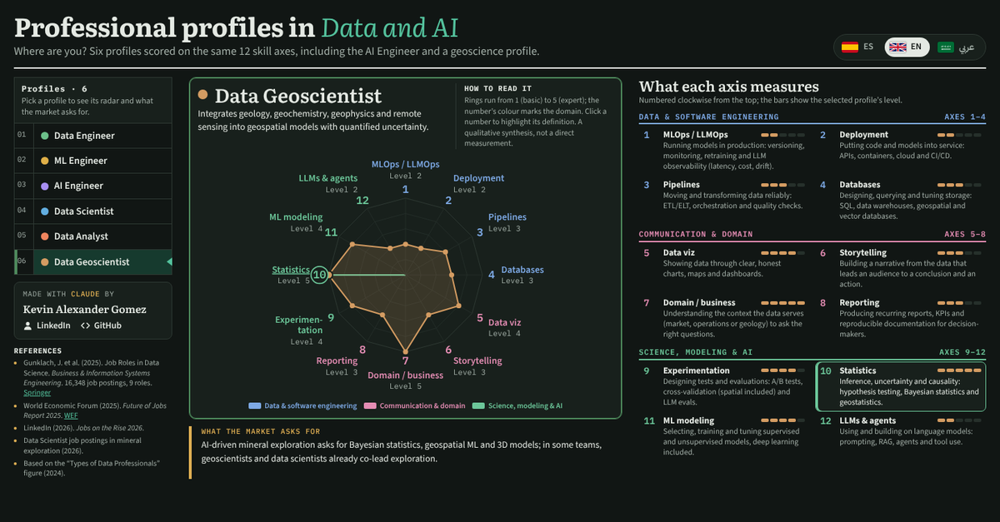

# Data and AI Profiles · Perfiles en Datos e IA

Interactive explorer of six professional profiles in data and AI, scored on the same 12 skill axes. It includes the AI Engineer and a **Data Geoscientist** profile, and reads in Spanish, English and Arabic.

**Live page:** https://kevinalexandr19.github.io/data-ai-profiles/

- Español: https://kevinalexandr19.github.io/data-ai-profiles/?lang=es
- English: https://kevinalexandr19.github.io/data-ai-profiles/?lang=en
- العربية: https://kevinalexandr19.github.io/data-ai-profiles/?lang=ar

## How to use it

- Pick a profile in the list to see its radar, description and what the market asks for.
- Click an axis number (1–12) to highlight its definition; click again to clear it.
- Each profile has its own link, for example `#data-geoscientist`.

## How to read the scores

Rings run from 1 (basic) to 5 (expert). The scores are a qualitative synthesis of the sources below, not direct measurements.

## Sources

- Gunklach, J. et al. (2025). Job Roles in Data Science. *Business & Information Systems Engineering*. https://link.springer.com/article/10.1007/s12599-025-00954-2
- World Economic Forum (2025). *Future of Jobs Report 2025*. https://www.weforum.org/publications/the-future-of-jobs-report-2025/
- LinkedIn (2026). *Jobs on the Rise 2026*.
- Data Scientist job postings in mineral exploration (2026).
- Based on the “Types of Data Professionals” figure (2024).

## Credits

Made with Claude by **Kevin Alexander Gomez** · [LinkedIn](https://www.linkedin.com/in/kevin-alexander-gomez/) · [GitHub](https://github.com/kevinalexandr19)

A single self-contained `index.html`: no build step and no dependencies beyond Google Fonts.

## License

[MIT License](LICENSE). If you reuse or adapt the figures or texts, please credit Kevin Alexander Gomez and link to this repository.
